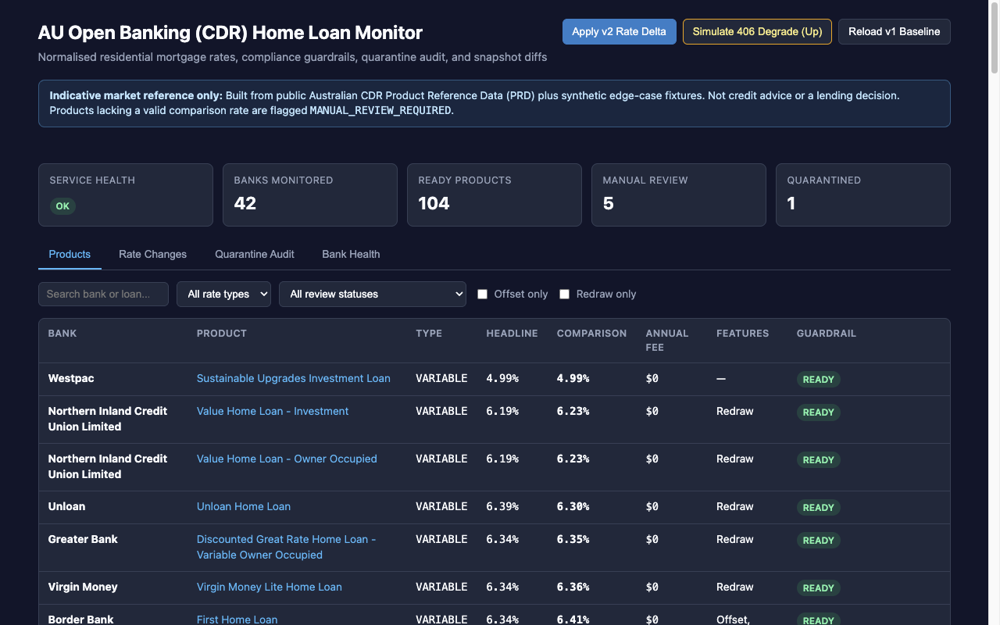

# AU Open Banking (CDR) Home Loan Rate & Change Monitor

A locally runnable vertical slice that ingests, validates, normalises, and compares public Australian **Consumer Data Right (CDR) Product Reference Data (PRD)** for residential mortgages (`RESIDENTIAL_MORTGAGES`) across **41 real Australian banks** (including Westpac, NAB, Macquarie, Up, Bendigo, Bank Australia, Unloan, ME Bank, BOQ, and more), tracks rate changes across snapshots, and enforces regulated-enterprise safety guardrails.

> **Indicative reference only:** Uses public unauthenticated CDR Product Reference Data plus synthetic edge-case fixtures. No private credentials, paid API keys, customer PII, or confidential data are used.



---

## Prerequisites
- **Node.js `>= 22.5.0`** (verified on Node `24.16.0`)
- **pnpm `10.x`** (`corepack enable` or `npm i -g pnpm`)

## Setup
```bash
pnpm install
```

## Run the Solution
```bash
pnpm dev
```
Open [http://localhost:3000](http://localhost:3000) in your browser. On first boot, the server runs versioned **Drizzle SQL migrations** (`drizzle/`) against `./data/cdr-monitor.db` (`better-sqlite3`) and seeds the bundled `sample-data/snapshots/v1/` snapshot (41 real AU banks + 1 synthetic edge-case fixture).

Regenerate migrations after schema changes:
```bash
pnpm run db:generate
```

Run snapshot ingestion via CLI:
```bash
pnpm run sync -- --version=v2
```

## Run All Verification Checks (CI Equivalent)
```bash
pnpm run verify
```
Runs `typecheck`, `oxlint` (100 rules including custom `local/no-comments`, `local/no-let`, `local/no-array-mutation`, and `local/no-classes`), `oxfmt --check`, `vitest` (37 BDD tests across 8 colocated files), `tsc` build, and an end-to-end smoke test booting `dist/index.js` against an ephemeral SQLite DB.

## Example Workflow (API)
```bash
# 1. Query normalised Westpac public CDR mortgages
curl -s "http://localhost:3000/api/products?bank=westpac" | jq '.products[] | {name, headlineRatePct, comparisonRatePct, reviewStatus}'

# 2. Inspect quarantined malformed payloads
curl -s "http://localhost:3000/api/quarantine" | jq '.records'

# 3. Apply v2 delta snapshot and view basis-point rate diffs
curl -s -X POST -H "content-type: application/json" -d '{"mode":"snapshot","version":"v2"}' http://localhost:3000/api/ingest
curl -s "http://localhost:3000/api/changes" | jq '.changes'

# 4. Simulate an upstream HTTP 406 degrade (last verified snapshot remains served)
curl -s -X POST -H "content-type: application/json" -d '{"mode":"simulate-degrade","bankSlug":"up"}' http://localhost:3000/api/ingest
curl -s "http://localhost:3000/health" | jq '{status, degradedCount}'
```

## Known Limitations
- Scoped to `RESIDENTIAL_MORTGAGES` only (excludes credit cards, savings, and authenticated CDR consumer data).
- Local persistence uses single-node SQLite (`node:sqlite`); multi-instance cloud deployment would swap `SqliteProductRepository` for managed PostgreSQL/Aurora behind `ProductRepository`.
- Primary rate selection picks a single representative Owner-Occupied P&I rate per product for comparison; multi-tier LVR pricing schedules are flagged for review where comparison rates are absent.

## Evidence Pack
- [evidence/intent.md](evidence/intent.md) — Problem statement, users, assumptions, scope, and success criteria
- [evidence/design.md](evidence/design.md) — Architecture, data flow, security/privacy, and cloud target shape
- [evidence/agentic-workflow.md](evidence/agentic-workflow.md) — AI coding tools used, decomposition, steering/interventions, and review process
- [evidence/verify.md](evidence/verify.md) — Checks run, results, known gaps, and local vs CI split
- [evidence/operate.md](evidence/operate.md) — Runbook, logs/health, config, failure modes, and local-to-cloud promotion
- [evidence/decisions.md](evidence/decisions.md) — Architecture Decision Records (ADRs) and intentional non-goals
