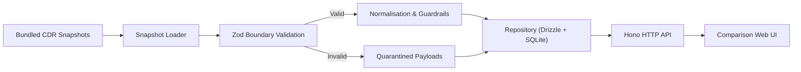

# Design

## Architecture

The service is a small TypeScript/Node.js monolith separated into ingestion, pure domain logic, relational persistence, and an HTTP API with a lightweight web UI. Dependencies like the clock, logger, and repository are passed in explicitly rather than wired globally, and the codebase uses plain functions and immutable data instead of classes.

## Data flow

1. The loader reads public CDR snapshot files and validates each product record at the boundary.
2. Malformed records are quarantined with their validation errors while valid products continue.
3. Valid mortgage products are normalised to a representative Owner-Occupied P&I rate, percentage points, and integer-cent fees. Products missing a comparison rate or with out-of-bounds/diverging rates are flagged for manual review instead of being treated as ready.
4. Each snapshot commit runs inside a single database transaction covering the sync audit record, normalised products, quarantined payloads, and bank status so readers never see half-updated rates.
5. The HTTP layer serves filtered product comparisons, product detail, quarantine records, basis-point diffs between snapshots, and health status.

## Security and privacy

- Only public CDR Product Reference Data and synthetic fixtures are used—no PII, customer data, or secrets.
- External JSON and query inputs are validated with Zod, and all database access uses parameterised Drizzle queries.
- There are no outbound network requests at runtime.
- Unexpected server errors are logged with a request ID and return a generic 500 response.

## Cloud deployment shape

In an enterprise cloud environment (AWS or Azure), this would run as a containerised Node service behind an API Gateway and WAF with internal OIDC or mTLS authentication. The SQLite repository would be swapped for Drizzle on managed PostgreSQL (such as Aurora Multi-AZ with KMS encryption) behind the same repository interface. A separate scheduled worker would pull upstream CDR feeds with circuit breakers and alerting on quarantine spikes, while CI/CD promotes immutable container builds through staging soak tests into production with health-gated rollbacks.
